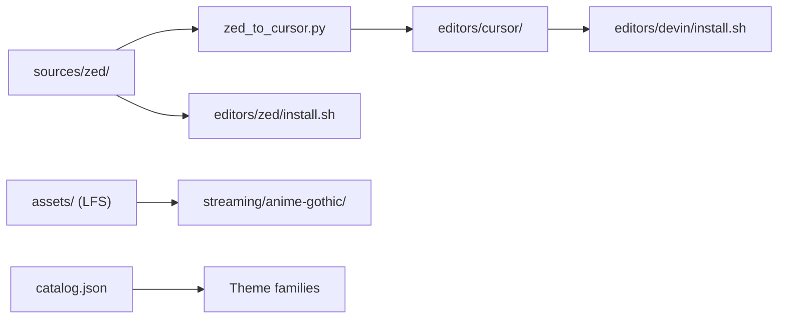

# Technical Specification — Dark Heart Labs Themes

## Overview

Unified monorepo for Zed, Cursor, Devin Desktop, and streaming themes (Cyberpunk, MTG, Anime Gothic) with canonical Zed JSON sources and generated Cursor extensions.

## Problem statement

Editor and streaming themes scattered across multiple repositories are hard to install, version, and keep consistent across platforms.

## Solution summary

Single monorepo with `sources/zed/` as canonical theme JSON, Cursor generation via `zed_to_cursor.py`, install scripts per platform, and streaming assets under `streaming/anime-gothic/`.

## Architecture

### Components

| Component | Responsibility |
|-----------|----------------|
| `sources/zed/` | Canonical theme JSON per family |
| `editors/cursor/` | Generated VS Code/Cursor extension |
| `editors/devin/` | Devin Desktop installer for the same extension (`~/.devin/extensions`) |
| `editors/zed/` | Zed installer |
| `streaming/anime-gothic/` | Discord, Twitch, OBS packs |
| `catalog.json` | Master family index |
| `scripts/install-all.sh` | Cross-platform install |

## Tech stack

| Layer | Technology |
|-------|------------|
| Editor themes | Zed JSON, Cursor/VS Code extension format (also consumed by Devin Desktop) |
| Generation | Python (`zed_to_cursor.py`) |
| Streaming assets | Git LFS |
| Install | Shell scripts |

## Deployment

- **Clone with LFS:** `git lfs install && git clone ... && git lfs pull`
- **Install all:** `./scripts/install-all.sh`
- **Regenerate Cursor:** `cd editors/cursor && python3 scripts/zed_to_cursor.py`

## Evidence map (reviewer paths)

| Concern | Path |
|---------|------|
| Canonical sources | `sources/zed/` |
| Catalog | `catalog.json` |
| Cursor extension | `editors/cursor/` |
| Devin Desktop installer | `editors/devin/` |
| Zed installer | `editors/zed/` |
| Migration notes | `docs/MIGRATION.md` |

---

**Maintained by:** [Dark Heart Labs](https://darkheartlabs.technology)  
**Author:** Jennifer ([@jv-darkheartlabs](https://github.com/jv-darkheartlabs))  
**Site:** https://darkheartlabs.technology
